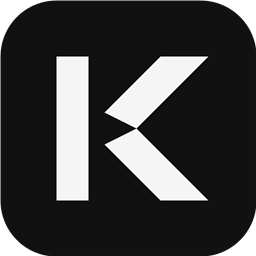
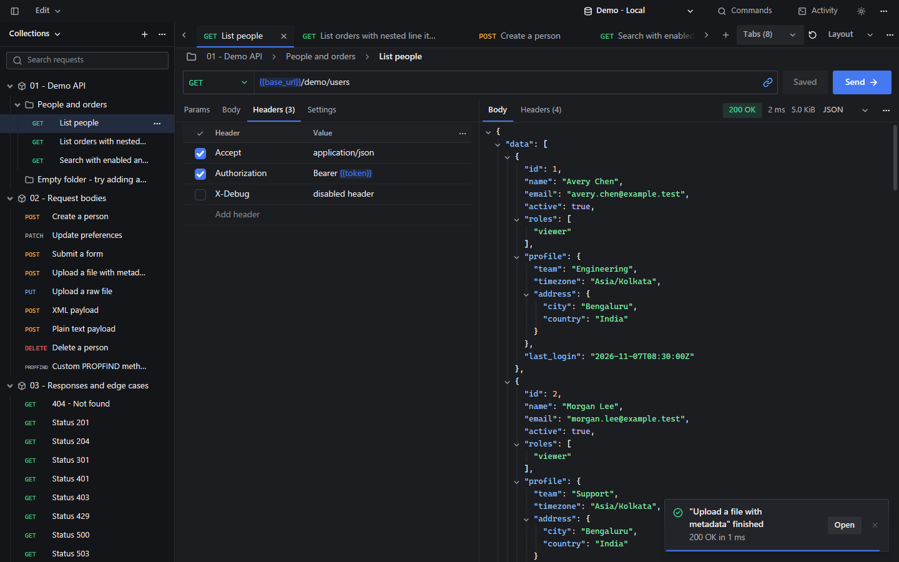
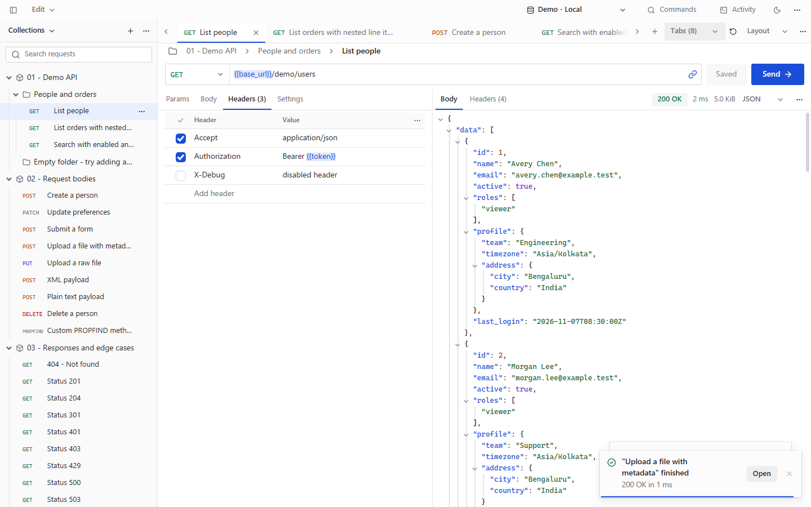
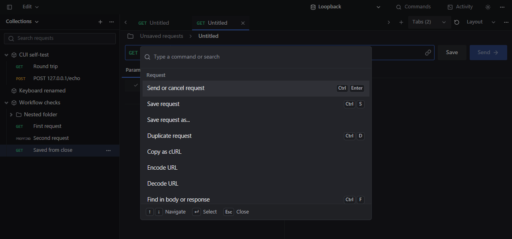
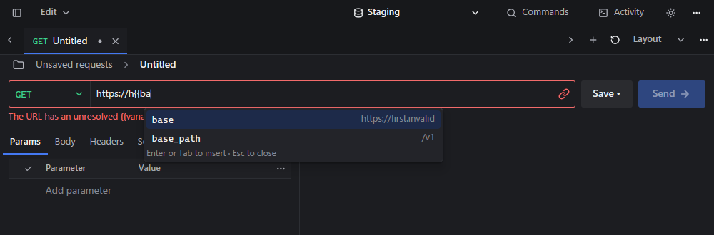

<p align="center">
  
</p>

<h1 align="center">Kest</h1>

<p align="center">
  <b>A fast, native HTTP client for Windows.</b><br>
  Built with Zig and CUI. No browser engine, no account, no telemetry — one 3.4 MB exe.
</p>

<p align="center">
  <a href="https://github.com/Prit36/kest/releases/latest"></a>
  
  
  <a href="LICENSE"></a>
</p>

<p align="center">
  
</p>

Most API clients are a browser in disguise: slow to start, heavy on memory, and
asking you to sign in. Kest draws its own UI on the GPU, starts instantly, keeps
your collections as plain files on disk, and never talks to anything but the
servers you send requests to.

## Features

- **Collections, folders and tabs.** A compact tree with drag-to-reorder, up to 64
  open request tabs that restore across restarts, breadcrumbs, and Save / Save as.
- **Environments and variables.** Type `{{` anywhere — URL, tables, body — to get
  suggestions; references are coloured and show their value on hover. Unresolved
  variables are flagged before you send.
- **Every kind of body.** JSON, text, XML, URL-encoded and multipart forms with file
  fields, and raw binary uploads. The body editor has Find and Replace with regex,
  JSON formatting and folding, multiple carets and column selection.
- **Responses you can read.** Folding JSON tree with JSONPath filtering, raw/text/minified
  views, Markdown and HTML previews, images, hex for binary data, and fast search even
  in multi-megabyte responses. Headers, timing and sizes are one hover away.
- **Clear failures.** HTTP errors keep their bodies; cancel, timeout and transport
  failures each get their own state with technical details.
- **Spreadsheet-like tables** for params, headers and form fields: resize, sort,
  multi-select, drag to reorder, bulk edit and paste tab-separated rows.
- **Import and export** Postman v2.1 collections and environments, cURL commands,
  and Kest's own `.kest.json` format. Copy any request as cURL.
- **Keyboard first.** A command palette (Ctrl+Shift+P), Ctrl+Enter to send or cancel,
  and shortcuts for everything else.
- **Native feel.** Segoe UI and Cascadia Mono through DirectWrite with ClearType,
  light and dark themes, side-by-side or stacked layout.

<p align="center">
  
</p>

<p align="center">
  
  
</p>

## Install

Download from [Releases](https://github.com/Prit36/kest/releases/latest):

- `Kest-<version>-windows-x64.zip` — unzip and run `kest.exe`. No installer needed.

Your data lives in `%APPDATA%\kest-cui` (set `KEST_DATA` to use another folder).

> The builds aren't code-signed yet, so Windows SmartScreen may warn on first run:
> choose **More info → Run anyway**.

### Try the demo

Run `kest.exe --demo` to open a fresh, throwaway workspace with five sample collections,
three environments and a built-in local API — no internet or setup needed. Your own
collections are never touched.

## Shortcuts

| Keys | Action |
| --- | --- |
| Ctrl+Enter | Send or cancel |
| Ctrl+N / Ctrl+S / Ctrl+D / Ctrl+W | New, save, duplicate, close request |
| Ctrl+Shift+P | Command palette |
| Ctrl+F | Find in body or response |
| Ctrl+B / Ctrl+J | Toggle sidebar / activity console |
| Ctrl+Tab | Cycle request tabs |

## Build from source

Requires [Zig](https://ziglang.org/download/) 0.17.0 on Windows x64. The first build
downloads the pinned [CUI](https://github.com/yappologistic/CUI) source; no CMake,
C compiler or Node is needed.

```sh
zig build run -Doptimize=ReleaseFast            # build and run
zig build run -Doptimize=ReleaseFast -- --demo  # run the demo workspace
zig build test                                  # engine and headless UI tests
```

The app is `zig-out/bin/kest.exe`; ship the `zig-out/licenses` folder with it.
The networking and storage engine is portable, but only a Windows host exists so far.

The [guide](docs/guide.md) covers every editor, shortcut and diagnostic flag in detail.

## License

[MIT](LICENSE). CUI is MIT licensed; the bundled Inter/Geist fonts and Lucide icons
carry their own licenses, included with every build.
